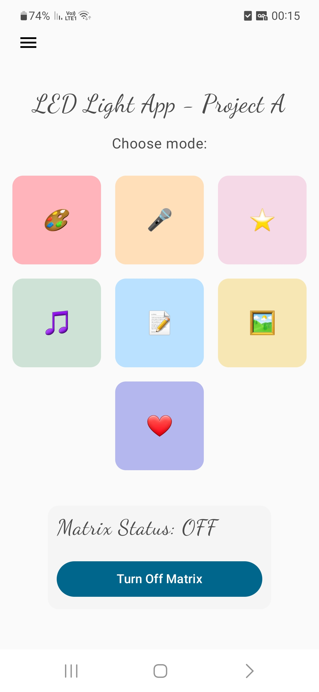

# LedLightApp — Android Client

Native Android mobile application developed in **Kotlin** using **Jetpack Compose**, serving as the user interface and signal-processing client for the IoT LED Matrix and Laser Projection system.

The application communicates with the ESP32 through Firebase Realtime Database, allowing users to control hardware remotely and interact with several software-based features.

---

## Tech Stack

| Category | Technology |
| :--- | :--- |
| Programming Language | Kotlin |
| UI Framework | Jetpack Compose |
| Design System | Material 3 |
| Cloud Integration | Firebase Realtime Database |
| Networking | Retrofit, OkHttp |
| Image Loading | Coil |
| Video Integration | YouTube Android Player |
| Hardware APIs | Android CameraX |

---

## Application Architecture

The application is organized into independent screens and supporting components, separating user interface logic, application state, and communication with external services.

### Main Application Modules

* **Home & Navigation:** Provides access to the different operating modes and application features.
* **Matrix Control:** Controls LED colors, scrolling text, preset icons, and image display.
* **Laser Projection:** Provides predefined vector shapes and a custom drawing interface.
* **Karaoke:** Handles YouTube video information, lyrics retrieval, and synchronized text display.
* **Heart Rate Monitoring:** Captures camera data and processes optical signals to estimate BPM.

---

## Application Screenshots

---

## Core Features & Algorithms

### 1. Custom Vector Drawing

* Provides an interactive touch canvas where users can draw continuous freehand shapes.
* Applies the **Ramer–Douglas–Peucker (RDP)** algorithm to reduce redundant touch points while preserving the overall geometry.
* Normalizes the simplified coordinates into a `0–99` integer grid.
* Sends the optimized vector path to Firebase for execution by the ESP32 laser projection system.

### 2. Camera-Based Heart Rate Monitoring (PPG)

* Uses the smartphone camera and flash to capture subtle skin-color variations caused by changes in blood volume.
* Extracts an optical intensity signal from the camera frames.
* Applies a custom **Butterworth biquad band-pass filter** to isolate the frequency range associated with heart rate.
* Estimates BPM from the filtered signal and synchronizes the result with the ESP32 LED matrix.

### 3. Gallery Image Processing

* Allows users to select images from their smartphone gallery.
* Resizes and converts images into a `32×16` RGB representation.
* Converts the image into a 512-pixel array suitable for Firebase transmission.
* The ESP32 reconstructs the pixel array and renders it on the LED matrix.

### 4. Synchronized Karaoke

* Integrates YouTube video information and song lyrics.
* Retrieves timestamped lyrics and displays them line-by-line on the LED matrix.
* Synchronizes the displayed lyrics using the current line (`currentLine`) and dynamically calculated scrolling speed (`scrollSpeed`).

### 5. LED Matrix & Laser Control

* Provides controls for LED colors and scrolling text.
* Supports preset pixel-art icons and laser vector shapes.
* Communicates operating modes and user commands to the embedded controller through Firebase.

---

## Firebase Integration

Firebase Realtime Database acts as the communication layer between the Android application and ESP32 firmware.

The application updates command values and operating modes in the database. The ESP32 listens for these updates and executes the corresponding hardware operations.

This architecture allows remote control without requiring a direct USB or Bluetooth connection between the phone and the microcontroller.

---

## Setup & Installation

### Prerequisites

* Android Studio
* Android SDK 36
* A Firebase project with Realtime Database enabled
* A physical Android device (recommended for camera-based PPG testing)

### Installation Steps

1. Clone the repository.
2. Open Android Studio and select **File → Open**.
3. Select the `Android App` directory.
4. Place your Firebase configuration file (`google-services.json`) inside the `app/` module directory.
5. Configure any required API keys in the project's local configuration.
6. Wait for Gradle synchronization to complete.
7. Build and deploy the application to an Android device.

---

## Hardware Communication

The Android application communicates with the ESP32 through Firebase rather than directly controlling the hardware.

The application is responsible for preparing and transmitting commands and data, while the embedded firmware handles the physical execution of these commands.