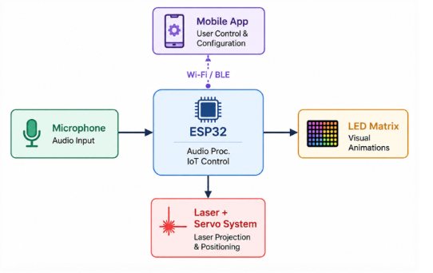

# Led-Light-Project: Interactive IoT LED Matrix & Laser Projection System

An end-to-end IoT embedded hardware and mobile application system developed by **Na'ama Dreifuss and Eilon Shany** at the **Technion – Israel Institute of Technology**.

The system enables wireless control over a 32×16 RGB LED matrix and a dual-axis servo laser projector through an Android application. It also includes audio-reactive visualizations and a smartphone camera-based heart rate monitoring feature.

---

## System Architecture

The system consists of three main layers:

* **Frontend (Mobile Client):** Native Android application developed in Kotlin using Jetpack Compose. Provides the user interface for controlling the LED matrix, laser projector, and additional features.
* **Cloud Backend:** Firebase Realtime Database handles command synchronization and communication between the mobile application and embedded hardware.
* **Embedded Hardware:** ESP32 microcontroller receives commands from Firebase and controls the LED matrix, servo motors, laser module, and digital microphone.

### System Workflow

1. The user selects an operation through the Android application.
2. The application updates the corresponding command in Firebase Realtime Database.
3. The ESP32 receives the updated command and processes it.
4. The firmware activates the relevant hardware component and executes the requested operation.
5. The physical output is displayed through the LED matrix or laser projection system.

---

## Key Features

* **32×16 RGB LED Matrix Display:** Displays scrolling text, custom pixel art, gallery images, synchronized karaoke lyrics, live BPM readings, and audio-reactive visualizations.
* **Dual-Axis Laser Vector Projection:** Projects predefined geometric shapes and custom freehand drawings using two servo motors.
* **Custom Freehand Drawing:** Converts user touch input into optimized vector paths using the Ramer–Douglas–Peucker (RDP) algorithm.
* **Camera-Based Heart Rate Monitoring:** Uses smartphone camera photoplethysmography (PPG) and digital signal processing to estimate heart rate.
* **Audio-Reactive Visualizations:** Uses an I2S digital microphone and FFT processing to generate audio-responsive LED animations.

---

## Repository Structure

| Directory | Description |
| :--- | :--- |
| [`Android App/`](./Android%20App) | Native Android application, UI screens, Firebase integration, image processing, and signal processing algorithms. |
| [`ESP32-Hardware/`](./ESP32-Hardware) | Embedded C++ firmware, LED matrix control, laser vector projection, and Firebase communication. |

Each directory contains its own README with detailed architecture, implementation, and setup instructions.

---

## Technologies

| Category | Technologies |
| :--- | :--- |
| Mobile Development | Kotlin, Android Studio, Jetpack Compose |
| Embedded Development | C++, ESP32, Arduino Framework |
| Cloud Communication | Firebase Realtime Database |
| Signal Processing | FFT, Digital Filtering, PPG |
| Hardware | WS2812B LED Matrix, MG90S Servos, Laser Module, INMP441 Microphone |

---

## System Architecture

---

## Getting Started

To explore or run the project:

1. Start with the Android application documentation: [`Android App README`](./Android%20App/README.md).
2. Continue with the embedded hardware documentation: [`ESP32 Hardware README`](./ESP32-Hardware/README.md).
3. Configure Firebase so that both components communicate through the same Realtime Database project.

Each component has its own configuration and installation requirements.

---

## Authors

* **Na'ama Dreifuss** — Electrical Engineering Undergraduate, Technion – Israel Institute of Technology ([GitHub](https://github.com/naamadreifuss))
* **Eilon Shany** — Project collaborator